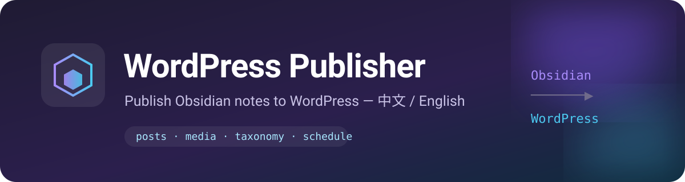

# WordPress Publisher for Obsidian

[](https://github.com/spark-ai-boy/obsidian-wordpress-publisher/releases)
[](https://github.com/spark-ai-boy/obsidian-wordpress-publisher/actions/workflows/ci.yml)
[](LICENSE)
[](https://obsidian.md)
[](https://wordpress.org)

[中文](README.md) · **English**



Publish Obsidian notes to WordPress with post creation/updating, categories and tags, featured images, inline media uploads, scheduling, multiple sites, previews, conflict protection, and publish history.

> Unofficial project. Not affiliated with Obsidian, WordPress, or Automattic.

---

## Contents

- [Features](#features)
- [Requirements](#requirements)
- [Installation](#installation)
- [Set up WordPress](#set-up-wordpress)
- [Set up the plugin](#set-up-the-plugin)
- [Usage](#usage)
- [Frontmatter reference](#frontmatter-reference)
- [How content is converted](#how-content-is-converted)
- [Multiple sites](#multiple-sites)
- [Security and privacy](#security-and-privacy)
- [Troubleshooting](#troubleshooting)
- [Development](#development)
- [Releasing](#releasing)
- [Contributing](#contributing)
- [License](#license)

---

## Features

| Area | Capability |
| --- | --- |
| Publishing | Create a post from the current note; automatically update the linked post from frontmatter |
| Statuses | Draft, publish, pending review, private, and scheduled (`future`) |
| Content | Obsidian Markdown rendered to HTML, including code, tables, task lists, footnotes, and callouts |
| Titles | Use the first H1 as the title and optionally remove the duplicate H1 from the body |
| Categories | Full category tree, search, multi-select, and create a category from the publish dialog |
| Tags | Comma-separated input; existing tags are reused and missing tags are created |
| Featured image | Pick from the vault, enter a URL, use the first content image, or auto-use the first uploaded image |
| Inline media | Upload vault images to the media library and rewrite links; optionally mirror remote images; media cache avoids duplicates |
| Post fields | Slug, excerpt, format, comments, pingbacks, sticky, password protection, and remove an existing password |
| Scheduling | Date/time picker interpreted in the WordPress site timezone |
| Preview | Approximate in-app preview of the title, excerpt, and rendered body |
| Multiple sites | Unlimited profiles with per-site credentials, defaults, categories, and tags |
| Conflict protection | Detects remote edits and requires explicit confirmation before overwriting |
| Workflow | Ribbon, command palette, file context menu, quick publish, status bar, and history |
| Languages | Complete Chinese and English UI, optionally following Obsidian |
| Mobile | Uses Obsidian `requestUrl`; works on desktop and mobile |

---

## Requirements

- **Obsidian** 1.5.0 or newer.
- **WordPress** 5.6 or newer (Application Passwords are in core since 5.6).
- The WordPress REST API must be reachable, and permalinks must not be set to Plain.
- **HTTPS** is strongly recommended and normally required by WordPress for application passwords. Local development can use `WP_ENVIRONMENT_TYPE=local`.
- The primary target is **self-hosted WordPress**. WordPress.com and similar hosts may require OAuth or restrict REST writes and are not currently supported.
- The WordPress user needs enough capability:
  - To publish: `publish_posts`, `edit_posts`, `upload_files`, and `manage_categories` (for creating terms).
  - A Contributor can usually submit pending posts but cannot upload media or manage categories.
  - An Administrator has all required capabilities.

> This plugin uses the standard WordPress REST API and does not require a companion WordPress plugin. Some security plugins, WAFs, or reverse proxies block `/wp-json/` or the `Authorization` header; allow-list them if needed.

---

## Installation

### Manual installation

1. Download `main.js`, `manifest.json`, and `styles.css` from [Releases](https://github.com/spark-ai-boy/obsidian-wordpress-publisher/releases).
2. Create this folder in your vault:

   ```text
   <your-vault>/.obsidian/plugins/wordpress-publisher/
   ```

3. Copy all three files into the folder.
4. Restart Obsidian, open **Settings → Community plugins**, disable Restricted mode, and enable **WordPress Publisher**.

### BRAT

1. Install and enable [BRAT](https://github.com/TfTHacker/obsidian42-brat).
2. Choose **Add Beta plugin** and enter `spark-ai-boy/obsidian-wordpress-publisher`.

> Official Obsidian community plugin listing requires a separate review. The repository follows the standard plugin layout and can be installed manually or with BRAT today.

---

## Set up WordPress

### 1. Create an Application Password

1. Sign in to WordPress.
2. Go to **Users → Profile**.
3. Scroll to **Application Passwords**.
4. Enter a name such as `Obsidian` and select **Add New Application Password**.
5. Copy the generated password (for example `abcd EFGH 1234 ijkl MNOP 6789`). It is shown only once.

Never use your main account password. An application password can be revoked independently.

### 2. Verify the REST API

Open this URL in a browser:

```text
https://your-site.example/wp-json/wp/v2/
```

A JSON response means the API is reachable. A 404, 403, login page, or HTML response means a permalink, security plugin, firewall, or server configuration issue must be fixed first.

### 3. Enter the site URL correctly

Use the site root, **without** `/wp-json`:

```text
✅ https://example.com
✅ https://example.com/blog
❌ https://example.com/wp-json/wp/v2
```

Keep the subdirectory when WordPress is installed in one.

---

## Set up the plugin

Open **Settings → WordPress Publisher**.

### Language

Choose **Auto** (follow Obsidian), **中文**, or **English**. Interface text updates immediately; restart Obsidian to refresh command names in the command palette.

### Add a site

| Field | Meaning |
| --- | --- |
| Display name | A label such as “My Blog” |
| Site URL | WordPress root, optionally including a subdirectory |
| Username | WordPress login name, not the email address |
| Application password | The generated password; spaces are allowed |
| Default status | Default for new posts |
| Default format | WordPress post format |
| Default categories | Per-site defaults, multi-select |
| Default tags | Per-site defaults, comma-separated |

**Test connection** validates the credentials and loads categories. You can manage multiple sites from the settings page.

### Publishing defaults

The settings page configures these for the **active site**:

- Default post status
- Default post format
- Default comment status
- Default pingback status

### Content handling

| Setting | Default | Description |
| --- | --- | --- |
| Use first H1 as title | On | Pre-fill the title from a leading H1 |
| Remove duplicate H1 | On | Remove the H1 from the body when it matches the final title |
| Use note tags | On | Pre-fill tags from YAML/inline tags when no WordPress tags are stored |
| Upload local images | On | Upload vault images and rewrite their links |
| Upload remote images | Off | Download and upload `http(s)` images; off by default to avoid surprises |
| Auto featured image | Off | Use the first uploaded content image when none is selected |
| Wiki links | Text | Optionally link to already-published posts |

### Workflow

- **Open post after publishing**: launch the post in your browser.
- **Status bar**: show the current note's WordPress status; click it to publish.
- **Warn about remote changes**: compare the remote modified time and require confirmation before overwriting.

---

## Usage

### Publish a new post

1. Open a Markdown note.
2. Click the ribbon **upload-cloud** icon, use the command **Publish current note to WordPress**, or right-click the file and choose **Publish to WordPress**.
3. Review the title, status, slug, excerpt, categories, tags, and featured image.
4. Switch to **Preview** to check the body.
5. Select **Publish**.

On success the plugin writes frontmatter such as:

```yaml
wordpress_id: 123
wordpress_url: https://example.com/my-post
wordpress_site: https://example.com
wordpress_status: publish
wordpress_last_sync: 2026-10-31T14:00:00.000Z
wordpress_remote_modified: 2026-10-31T22:00:00
```

The next time you publish that note, the button becomes **Update post**.

### Update a post

Publish again. The plugin locates the post by `wordpress_id` + `wordpress_site`. If the WordPress post changed after the note's last sync, a conflict warning appears and you must confirm the overwrite.

When the note has no explicit slug or excerpt, updates preserve the existing WordPress slug and excerpt so permalinks and custom summaries are not changed accidentally. You can still edit or clear the excerpt in the publish dialog.

### Quick publish

Run **Quick publish current note (defaults)** from the command palette:

- No dialog.
- Uses note frontmatter, site defaults, and current settings.
- For an already-linked post, preserves remote format, categories, tags, featured image, comments, pingbacks, and sticky state where the note has no saved value.
- New posts cannot be scheduled from quick publish; use the dialog for scheduling.

### Preview

Use the **Preview** tab in the publish dialog, or the command **Preview current note for WordPress**. The preview is approximate; the WordPress theme controls the final appearance. Local images are displayed from Obsidian and are uploaded only when you publish.

### History

The command **Show WordPress publish history** lists created/updated posts with site, post ID, status, and note path. You can open the post or note, remove an entry, or clear the list. History is local only and does not affect WordPress or note frontmatter.

### Status bar

When enabled, the status bar shows `WordPress: Not published`, `Draft`, `Published`, `Pending review`, `Private`, or `Scheduled`. Click it to open the publish dialog.

---

## Frontmatter reference

All keys are optional and user-editable. Avoid editing sync timestamps unless you intentionally want to reset conflict detection.

| Key | Type | Purpose |
| --- | --- | --- |
| `wordpress_id` | number | Post ID; presence means update instead of create |
| `wordpress_site` | string | Site root URL used to match a configured profile |
| `wordpress_url` | string | Published post URL |
| `wordpress_status` | string | `draft`, `publish`, `pending`, `private`, or `future` |
| `wordpress_last_sync` | ISO timestamp | Last successful sync |
| `wordpress_remote_modified` | WordPress timestamp | Remote `modified` value at last sync, used for conflict detection |
| `wordpress_categories` | number[] | Category IDs |
| `wordpress_tags` | string[] | Tag names |
| `wordpress_featured_media` | number | Featured media ID |
| `wordpress_featured_image` | string | Featured image source path or URL |
| `wordpress_slug` | string | Actual WordPress slug |
| `wordpress_format` | string | WordPress post format |

### Optional input keys

| Key | Purpose |
| --- | --- |
| `title` / `wordpress_title` | Title when there is no H1 |
| `excerpt` / `wordpress_excerpt` / `description` | Excerpt |
| `slug` / `wordpress_slug` | Slug; `wordpress_slug` wins |
| `cover` / `image` / `featured_image` / `featured` | Featured image |
| `tags` / `tag` | Pre-fill WordPress tags |

### Publish a copy as a new post

Delete these keys from the copy:

```yaml
wordpress_id:
wordpress_url:
wordpress_last_sync:
wordpress_remote_modified:
```

Keep `wordpress_site` to default the copy to the same site.

### Unlink a note

Delete `wordpress_id` and `wordpress_site`. The remote post is not deleted.

---

## How content is converted

Publishing uses Obsidian's own Markdown renderer so the HTML stays close to what you see in Obsidian.

### Handled

- Fenced and inline code
- Tables, task lists, footnotes
- Blockquotes and callout structure
- Images: `![[image.png]]`, ``, remote URLs
- Wiki links: `[[Note]]`, `[[Note|alias]]`, `[[Note#heading]]`
- Markdown links to notes: `[text](Note.md)`
- Obsidian comments `%%...%%` are removed
- Frontmatter is excluded from the body

### Wiki and internal links

- **Keep display text**: `[[Note|alias]]` → `alias`.
- **Link to published posts**: if the target note has `wordpress_url` in frontmatter, generate a link; otherwise fall back to display text.

Non-image note embeds (`![[Note]]`) cannot be embedded in WordPress and degrade to text to avoid `app://` dead links.

### Images

- Local images require **Upload local images**. If disabled and the note contains local images, publishing stops instead of sending `app://` links.
- Images are uploaded to the WordPress media library and their Markdown links are replaced with the media URL.
- Media is cached by site, path, modification time, and size, so unchanged images are not re-uploaded.
- Missing local images are replaced with alt text and reported as a warning.
- Remote images stay hotlinked unless **Upload remote images** is enabled.
- Featured images can come from a vault path, URL, first content image, or the first uploaded image.
- Raw HTML local `` tags are not uploaded automatically; use Markdown or wiki image syntax.

### Not guaranteed

These depend on Obsidian plugin runtimes and may not work as plain HTML:

- Dataview / DataviewJS queries
- Excalidraw and Canvas
- Custom code blocks from other plugins
- Mermaid diagrams (may remain a code block; install a WordPress Mermaid plugin if desired)
- Note embeds, hover previews, and other Obsidian interactions

Use the preview before publishing.

---

## Multiple sites

- Add any number of WordPress profiles.
- The **Site** dropdown chooses the target. The site linked in `wordpress_site` is preferred over the active site.
- Publishing a note linked to site A while selecting site B creates a new post and rewrites the frontmatter to site B. The dialog warns you.
- To create a copy on the same site, remove `wordpress_id` before publishing.
- If a domain changes, update the site profile and `wordpress_site` in linked notes; otherwise the note is treated as belonging to a different site.

---

## Security and privacy

- The plugin only contacts sites you configure.
- Authentication uses a WordPress Application Password over HTTP Basic.
- **Use HTTPS**; HTTP transmits credentials in clear text.
- Credentials are stored unencrypted in `.obsidian/plugins/wordpress-publisher/data.json`.
  - Do not commit `data.json`.
  - Do not sync the vault to untrusted devices.
  - Revoke the application password in WordPress if it may have leaked.
- No telemetry or analytics are sent.
- Remote image downloads do not include WordPress credentials.
- Before publishing, HTML is scrubbed of `<script>`, `<style>`, `<iframe>`, inline event handlers, and `javascript:` links.
- WordPress still applies its own content filtering and permission model.

See [SECURITY.md](SECURITY.md) for reporting vulnerabilities.

---

## Troubleshooting

### 401 Authentication failed

- Use the WordPress login name, not the email address.
- Use an **Application Password**, not the main account password.
- Spaces in the application password are allowed; the plugin removes them.
- WordPress normally requires HTTPS for application passwords.
- Check that a security plugin or proxy is not stripping the `Authorization` header.
- Revoke and regenerate the application password.

### 404 REST API not found

- Visit `https://your-site/wp-json/wp/v2/` to verify.
- Re-save **Settings → Permalinks** (do not use Plain).
- Is the site URL missing a subdirectory?
- Is `/wp-json/` blocked by a WAF, CDN, or security plugin?
- Multisite may require a subsite path.

### 403 Forbidden

- Does the role have `publish_posts`, `upload_files`, and `manage_categories`?
- Is the account read-only or using a custom role?
- Does a security plugin block REST writes?

### Image upload fails

- The account needs `upload_files`.
- Check WordPress media settings and the host upload limit (413).
- WordPress blocks SVG by default; enable it deliberately if needed.
- The plugin sanitizes filenames to ASCII and sends the original name via `filename*`.
- Missing local images are replaced with alt text; check attachment paths.

### Published images are broken

- Was **Upload local images** disabled? Publishing is blocked for local images in that case.
- Raw HTML `` tags are not uploaded; use Markdown/wiki syntax.
- Hotlinked remote images may be blocked by the remote site.

### “Remote changed” keeps appearing

- This is expected if the post was edited in WordPress. Confirm the overwrite checkbox.
- If the remote post truly did not change, delete `wordpress_remote_modified` to fall back to timestamp comparison, or delete `wordpress_last_sync` to reset.
- Prefer `wordpress_remote_modified` when the computer and site use different timezones.

### Scheduled time is wrong

- The date/time is interpreted in the **WordPress site timezone**.
- Check **Settings → General** in WordPress.
- The plugin does not convert between your computer timezone and the site timezone.

### Quick publish changed a scheduled post to draft

- Quick publish cannot ask for a schedule for a new post and falls back to the site default.
- Linked scheduled posts attempt to preserve the remote schedule.
- Use the publish dialog when scheduling matters.

### Command names did not change with the language

- Restart Obsidian. Command names are registered at plugin load; other UI text updates immediately.

### Uninstall

1. Disable and remove the plugin in Obsidian.
2. Optionally delete `.obsidian/plugins/wordpress-publisher/`.
3. Revoke the application password in WordPress.
4. Published posts and note frontmatter remain.

---

## Development

### Requirements

- Node.js 20+
- npm 9+
- Obsidian 1.5+

### Local setup

```bash
git clone https://github.com/spark-ai-boy/obsidian-wordpress-publisher.git
cd obsidian-wordpress-publisher
npm ci
npm run dev
```

`npm run dev` watches the source and writes `main.js`, but does not copy it to a vault. Link the repository into a test vault:

```bash
ln -s "$PWD" "/path/to/your/vault/.obsidian/plugins/wordpress-publisher"
```

Windows:

```bat
mklink /J "C:\path\to\vault\.obsidian\plugins\wordpress-publisher" "C:\path\to\repo"
```

Reload the plugin in Obsidian after building.

### Scripts

```bash
npm run dev        # watch and bundle with inline sourcemap
npm run typecheck  # strict TypeScript check
npm run test       # Vitest unit tests
npm run build      # typecheck + production bundle
npm run check      # typecheck + tests + build
```

### Project layout

```text
src/
  main.ts                 Plugin entry, commands, status bar, events
  types.ts                Shared types
  constants.ts            Defaults, frontmatter keys, statuses, formats
  i18n/                   Chinese/English dictionaries and detection
  ui/                     Publish dialog, site/settings UI, history, image picker
  utils/                  URL, date, Markdown, frontmatter, path, error helpers
  wordpress/
    client.ts             WordPress REST client
    publisher.ts          Publish orchestration, conflicts, frontmatter
    media.ts              Image parsing, uploads, media cache
    notes.ts              Note reading and default options
    renderer.ts           Obsidian Markdown → HTML
    links.ts              Wiki/Markdown internal link conversion
tests/                    Vitest tests and Obsidian runtime stub
```

### Design constraints

- Network requests go through Obsidian `requestUrl` (mobile-compatible, no CORS issues).
- No runtime dependencies beyond Obsidian; the bundle stays small.
- TypeScript is strict. Every user-facing string must be added in both languages.
- Never log credentials in code, errors, or URLs.
- Add tests when changing publishing behavior.

### Adding a language

1. Copy `src/i18n/en.ts` and implement every `TranslationKey`.
2. Extend `LanguageSetting` / `ResolvedLanguage` in `src/types.ts`.
3. Add the dictionary and detection in `src/i18n/index.ts`.
4. Add the option to the settings tab.

---

## Releasing

```bash
npm version patch   # or minor / major
git push --follow-tags
```

`npm version` runs `scripts/version-bump.mjs`, which keeps `package.json`, `manifest.json`, and `versions.json` in sync. The tag workflow verifies versions, builds, and creates a GitHub release with `main.js`, `manifest.json`, and `styles.css`.

---

## Contributing

Issues and pull requests are welcome. Please read:

- [CONTRIBUTING.md](CONTRIBUTING.md)
- [CODE_OF_CONDUCT.md](CODE_OF_CONDUCT.md)
- [SECURITY.md](SECURITY.md)

Never paste application passwords, `data.json` contents, or credential-bearing headers into an issue.

---

## License

[MIT](LICENSE) © 2026 spark-ai-boy

WordPress is a trademark of the WordPress Foundation. Obsidian is a trademark of Dynalist Inc. This project is not affiliated with either.
